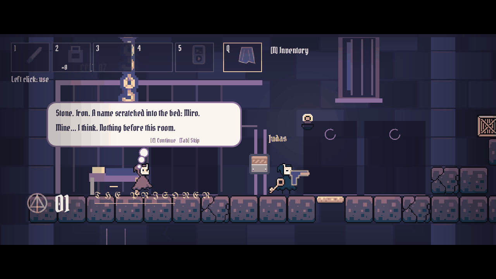
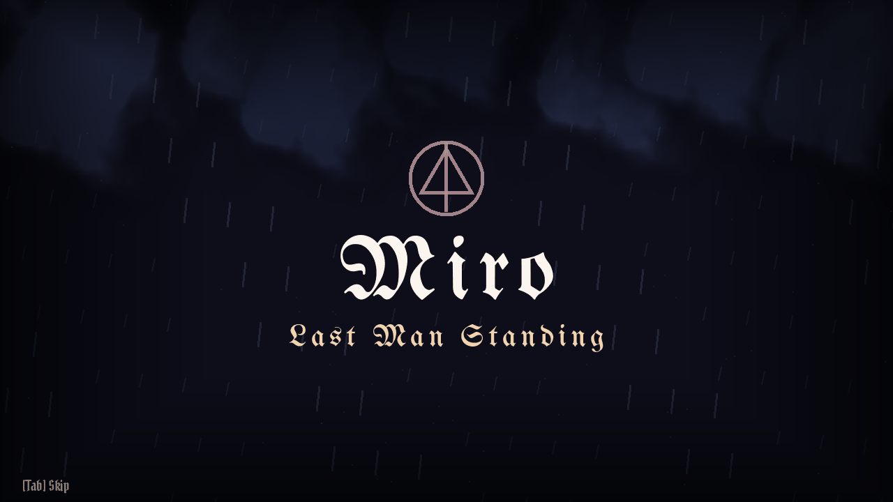

# Miro: Last Man Standing

**Miro** is a 2D pixel-art stealth platformer about a prisoner escaping a tower that does not want to let him go. You play Miro, Prisoner M-07, who wakes in Cell 07 with no memory of how he got there and only one idea: get out. Five floors stand between him and the ground, and every floor is louder, stranger and harder to trust than the one above it.

Built in Godot 4.7 by **RXLA (Ethan Risden)**, with an original soundtrack produced by RXLA.

> **No spoilers.** This README describes the setup and the first floors only. The story's later turns are left for you to find in the game.

---

## The story

A storm sits over the tower. Over the PA a voice orders lights out and cells sealed, and tells the guards to report every cough, *including their own*. Something is spreading through the building, and the people in charge would rather lock it inside than explain it.

Miro wakes in his cell. The guard on his door, the Keeper the prisoners call Judas, is coughing too. The uniform does not protect him any more than the bars protect anyone else. Miro has nothing to trade and no one to ask, so he starts with what he can reach.

From there the escape runs down through five floors:

| Floor | Name | What Miro finds |
|---|---|---|
| 01 | **The Prisoner** | His cell, a sick Keeper, and the first way out. Learn to move, hide, fight and pick a route. |
| 02 | **The Symptoms** | Below the cells the coughing has names. Some doors hold the sick, others anyone who stood beside them. |
| 03 | **The Order** | A checkpoint splits the tower. Cameras, controls and records that might explain why Miro is here. |
| 04 | **The Ward** | Sealed rooms, observation windows and no names on the charts. |
| 05 | **The Foundation** | The bottom of the tower, where everything else rests. Play it to find out. |

### What it's about

Miro is a game about **escape, isolation and distrust**.

- **The tower is a power structure.** It is not one villain. It is an institution with ranks, rules, uniforms and records, and it decides who is a prisoner, who is a guard and who is sick. Most of the people inside it, guards included, are trapped by it too.
- **Isolation.** Miro is alone, unsure of himself, and presented by the institution as dangerous. He learns about himself mostly from what the tower wrote down about him.
- **Distrust.** Guards trade favours and prisoners' belongings, voices reach Miro through a stolen MP3 player, and records are redacted "by order of the Ward". Everyone wants something, and nothing is quite what it is labelled.
- **Self-determination.** Miro's arc moves from confusion and survival toward choosing his own way out.

### Your choices change how the tower reacts

You can escape as a ghost or as a threat. Sneaking past guards leaves Miro **MISSING**, and the tower searches for him. Fighting through leaves him **HUNTED**, and the guards know exactly what he is doing. Kills have a cost: noise, discovered bodies and more armed guards. Stealth unlocks new tracks for Miro's MP3 player. Neither path changes the main story, but they change what the world says about Miro and what he thinks of himself.

Miro's inner conflict shows up in the tower itself. Two-option replies (one quiet, one defiant) and the way you play choose which public-domain paintings hang in the frames on later floors, from van Gogh's *Prisoners Exercising* to Friedrich's *The Monk by the Sea*. Lore terminals hold the prison's own records.

  
  

---

## How to play

### Run it

- **Windows build:** run `Miro.exe` from the release folder.
- **From source (Windows):** install Godot 4.7, then run `Play Miro.ps1`. `Play Miro.ps1 -Dev` opens every floor for debugging, and `Play Level.ps1 -Level 3` jumps straight to a floor.
- **From source (any OS):** open the folder in Godot 4.7 and press Play. The main scene is `scenes/main_menu.tscn`.

The music lives in Git LFS, so run `git lfs pull` after cloning.

### Controls

| Input | Action |
|---|---|
| A / D or arrows | Move |
| Space, then Space in the air | Jump, double jump (3-second recharge) |
| Space at a ledge / against a wall | Mantle up / wall bounce |
| Left Ctrl | Crouch |
| C | Dash |
| 1–5 | Select item: 1 shank, 2 C4, 3–4 guns, 5 MP3 player |
| Q | Select the blanket (hide in shadows for 5 seconds) |
| Left click | Use the selected item |
| Right click | Aim, or place C4 when C4 is selected |
| R | Reload |
| E | Interact, loot, pickpocket, continue dialogue |
| Z | Think: up to three escalating hints for the current objective |
| N | Inventory (click two slots to swap) |
| B | Next track on the MP3 player |
| Backspace | Retry the floor |
| Esc | Pause (the pause menu also lists the controls) |
| M / F10 | Mute sound effects / back to menu |

PlayStation controllers are supported. Settings → Controller shows the connected pad and lets you change deadzone, stick inversion and crouch mode. On Windows, transmissions to Miro's MP3 player can play through the DualSense speaker. The full mapping is in [docs/CONTROLS_REMOTE_HANDOFF.md](docs/CONTROLS_REMOTE_HANDOFF.md).

  
  

### Tips

- Guards have sight cones and will search where they last saw you. Shadows and the blanket keep you hidden. Leaving cover or touching a guard reveals you.
- Every floor is hand-authored and nothing is random. If you are stuck, press **Z** and Miro will think it through.
- Dialogue appears in bubbles over whoever is speaking. Miro's thoughts look different from speech, and they are your cues.

---

## The floors

  
  

  
  

Floors 2 to 4 are each built as two sub-floors of three storeys, laid out as a snake (east, west, east, then west, east, west), so each storey is a route to read and solve. Each sub-floor is long enough to carry one song of the soundtrack, and each floor has its own visual theme while keeping the tower's look.

---

## How it was built

### Engine and code

- **Godot 4.7** (Forward+), written entirely in **GDScript**. The game renders at 640×360 and scales to 1280×720 for crisp pixel art.
- **Data-driven levels.** Each floor is a JSON file in `data/levels/` (geometry, guards, items, story stations and openings). `tools/level_layouts.py` writes the authored layouts and ASCII maps (`docs/level_maps/`), and `tools/build_remaining_levels.gd` rebuilds the Godot scenes from that data.
- **Autoload services** (`project.godot`): `Campaign` (progress, unlocks, MISSING/HUNTED state), `MusicDirector` (soundtrack and beat clock), `SoundFX`, `RemoteRadio` (the MP3 player's radio transmissions), `ControllerSettings`, `PlayerBehavior` (attaches the inner-conflict system to each floor at runtime) and `Typeface`.
- **Story as data.** Guard conversations, inner thoughts, two-option replies, terminal logs, branch reactions and credits are JSON in `data/`, so writing changes don't touch code.

### Music system

- Every floor has its own tracks from RXLA's original soundtrack. The floor's first song plays on entry and the second takes over in the second half.
- `scripts/music_director.gd` crossfades two players and doubles as the game's **beat clock**. It emits `beat` and `bar` signals from the playing track, so guard patrols, waves and telegraphs land on the music.
- Tempos come from offline analysis (`tools/analyze_beats.py` → `data/music/beat_analysis.json`).
- The in-game MP3 player lets Miro swap to unlocked beats. Calm beats are unlocked by stealth and aggressive ones by fighting.

### Voices (ElevenLabs)

- Guards, the tower PA and other characters are voiced with **ElevenLabs** (`eleven_v3`, using audio tags for emotion). The cast and per-character delivery live in `data/voice_cast.json`.
- `tools/generate_voices.py` generates clips at build time and caches them by text/voice/settings hash. The game ships only the generated audio, never an API key.
- Transmissions on the MP3 player go through a bitcrushed radio bus, and Miro's voiced thoughts go through a distant, spacey reverb bus.

### Art pipeline

- **Original character and tile art** by Julia (Miro, the Keepers and the prison tiles).
- **CC0 asset packs from Kenney** (Tiny Dungeon, Pixel Platformer Industrial Expansion, particle, smoke, splat, emote, UI and input-prompt packs, plus impact and sci-fi sounds). Licences sit next to the assets in `assets/library/` and `assets/audio/`.
- **Public-domain paintings** for the reactive gallery. `tools/fetch_art.py` (run through `Fetch Art.ps1`) downloads each work from its museum or Wikimedia source, checks the source's public-domain/CC0 field, and records the evidence in `data/art_rights.json` and `docs/art_rights_manifest.csv`. The game shows only works marked verified, and anything else appears as a covered frame with the work's name.
- A palette shader (`scripts/library_palette.gdshader`) pulls the mixed packs into one look.
- Typefaces: **UnifrakturMaguntia** for titles and **Pirata One** for game text (SIL Open Font License).

### Cinematics

The opening, the floor cards and the ending are built in-engine (`scripts/opening_cinematic.gd`, `scripts/cinema.gd`, `scripts/ending_cinematic.gd`). Each cutscene is about 10 to 15 seconds and skippable. Cutscene sound is synthesised by `tools/synth_cine_audio.py`, and any cue can be swapped for an ElevenLabs sound effect with `tools/generate_cine_sfx_elevenlabs.py`.

### Testing: checks and a bot playthrough

- **`Run Checks.ps1`** runs about 30 headless Godot test scripts in `tools/test_*.gd`. They cover the intro and stealth route, every floor's layout and reachability, guards and security, dialogue layout, audio and music, controls (keyboard and PlayStation), the MP3 player, inventory and weapons, branches, the inner-conflict system and the ending. Any `ERROR`, `SCRIPT ERROR` or `FAIL` fails the run.
- **`Check Exported Playthrough.ps1`** exports a separate QA build and runs a bot (`tools/export_playthrough.gd`) through all five floors with real scene transitions, including the final floor and the full ending. It must report every check passed.
- `tools/capture_*.gd` scripts render the screenshots used for review (and in this README) under Xvfb.

### Windows export

- `Build Windows.ps1` exports the **Windows Desktop** preset to `build/windows/Miro.exe`.
- `Check Windows Build.ps1` launches the exported build and confirms it starts cleanly on its own.

---

## Repository map

| Path | Contents |
|---|---|
| `scenes/` | Main menu, intro (floor 1), `levels/level_02`–`05`, cinematics, reusable pieces (guard, ladder, cameras, notes) |
| `scripts/` | All GDScript: player, guards, campaign, music, cinematics, HUD, inventory, inner conflict |
| `data/` | Level definitions, dialogue, voice cast, art catalogue and rights, credits, beat analysis |
| `assets/` | Sprites, tiles, Kenney packs, paintings, fonts, music, voices and sound effects |
| `tools/` | Level builders, capture scripts, tests, voice/art/audio generators |
| `docs/` | Design notes and handoffs (see below) |

### Developer docs

[Setup](docs/SETUP.md) · [Intro and floor 1](docs/INTRO.md) · [Level design](docs/LEVEL_DESIGN.md) · [Floors 2–5](docs/LEVELS_02_05.md) · [Controls](docs/CONTROLS_REMOTE_HANDOFF.md) · [Gameplay decisions](docs/GAMEPLAY_DECISIONS.md) · [Inner conflict](docs/INNER_CONFLICT.md) · [Music tracklist](docs/MUSIC_TRACKLIST.md) · [Cutscene hooks](docs/CUTSCENE_HOOKS.md) · [Playtest handoff](claudehandoff.md)

> Some developer docs discuss the full story. Read them after you finish the game.

Canonical repository: [xynprize/Miro.](https://github.com/xynprize/Miro.) (the name includes the final period).

---

## Credits

- **A game by** RXLA (Ethan Risden): story, direction and music
- **Character and tile art:** Julia
- **Playtesting:** Fran
- **Voices:** generated with ElevenLabs
- **Asset packs:** Kenney (kenney.nl), CC0
- **Typefaces:** UnifrakturMaguntia and Pirata One (SIL OFL)
- **Paintings:** public-domain works, with sources in `docs/art_rights_manifest.csv`
- **Made with** Godot Engine

*For everyone the tower kept.*
