# Miro: Last Man Standing

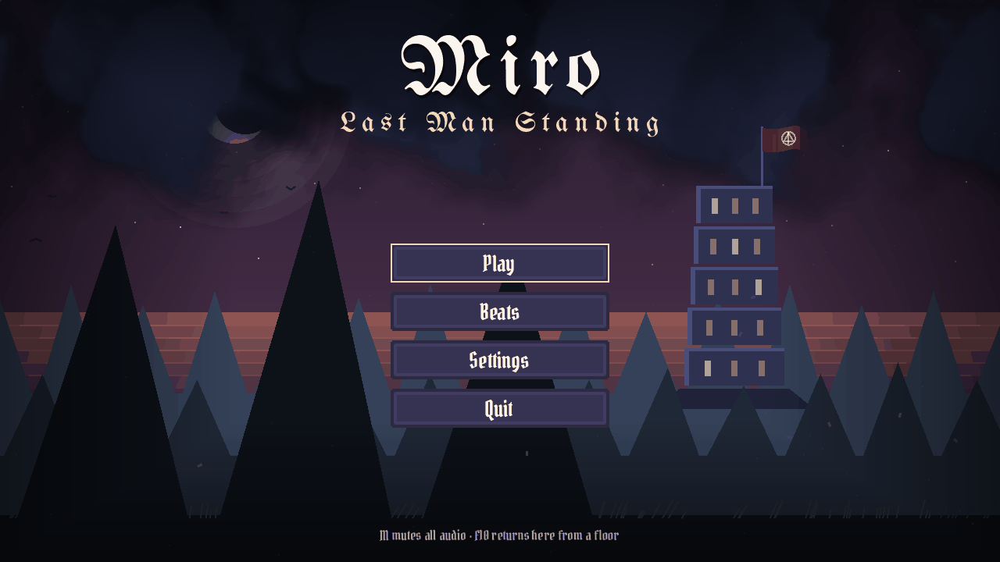

**Miro** is a 2D pixel-art stealth platformer about escape, isolation and distrust. You play Miro, Prisoner M-07, who wakes in a cell at the top of a tower with no memory of how he got there. A sickness is spreading through the building, and the guards are coughing too. Miro has to get down five floors to the ground, sneaking past guards or fighting through them, and the tower reacts to which one he chooses. The tower itself is the antagonist: a power structure of ranks, rules and records that traps prisoners and guards alike.

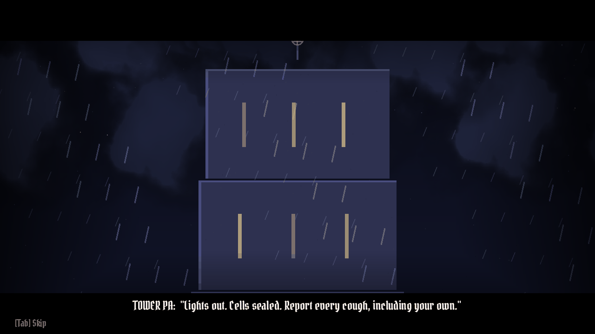

  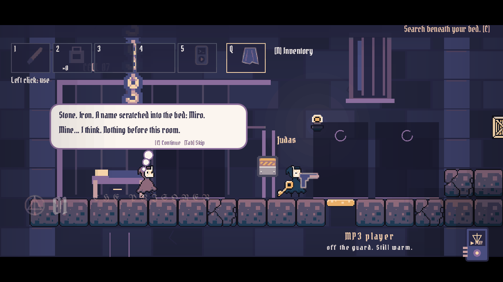
  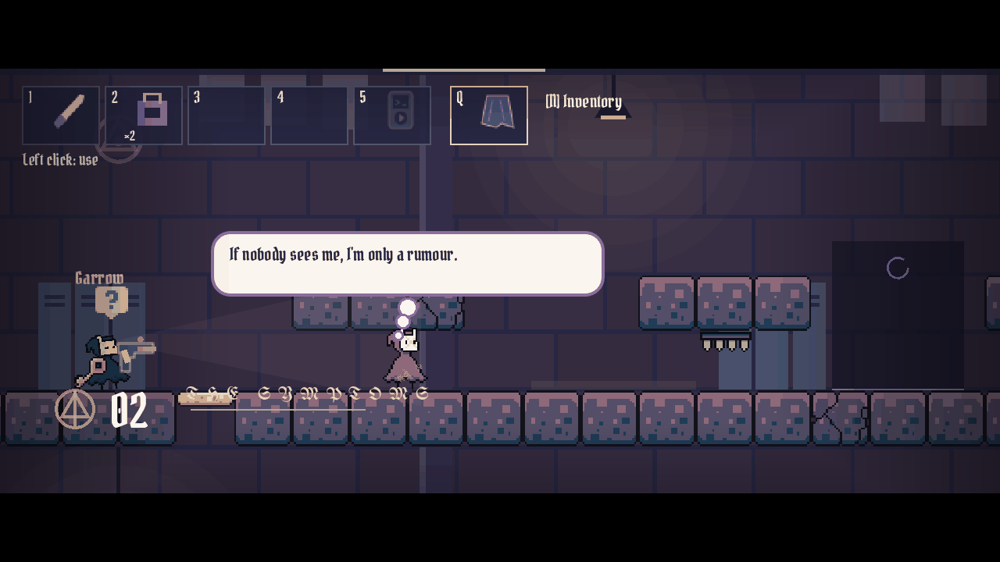

  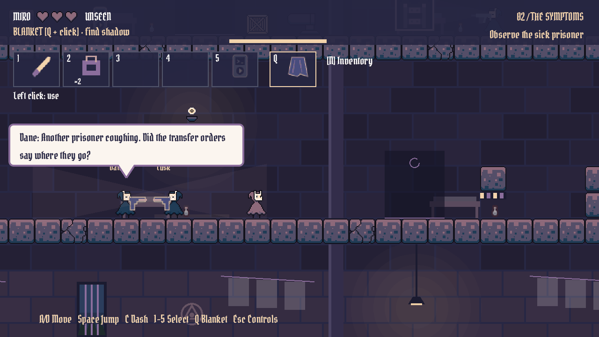
  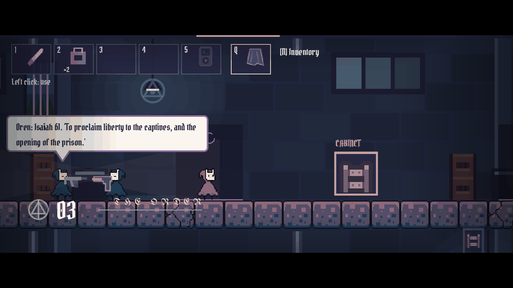

  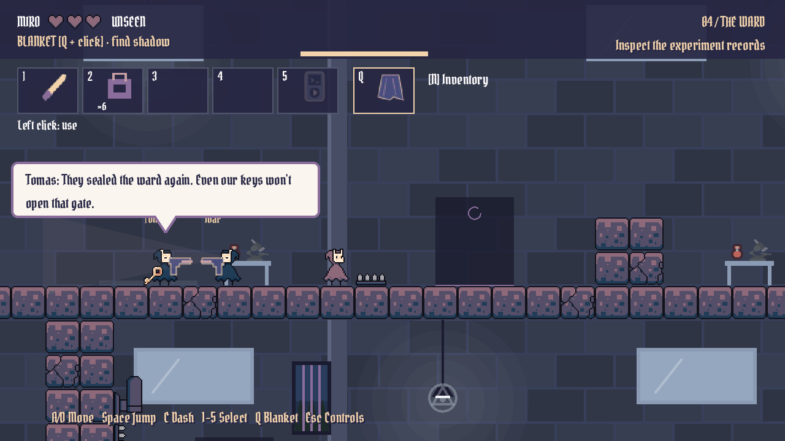
  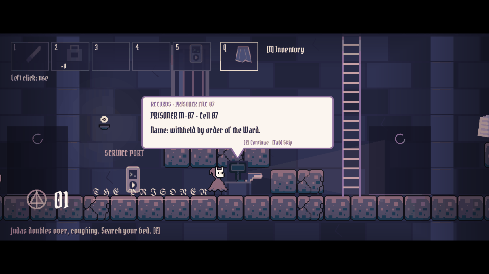

  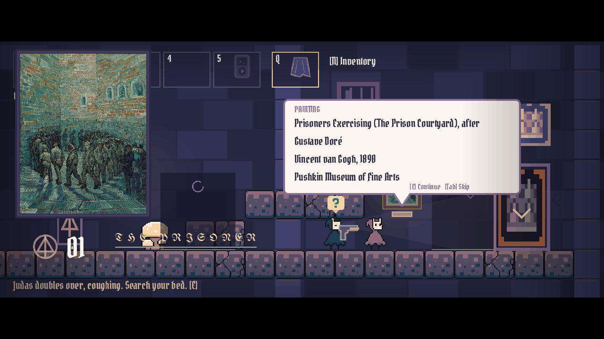
  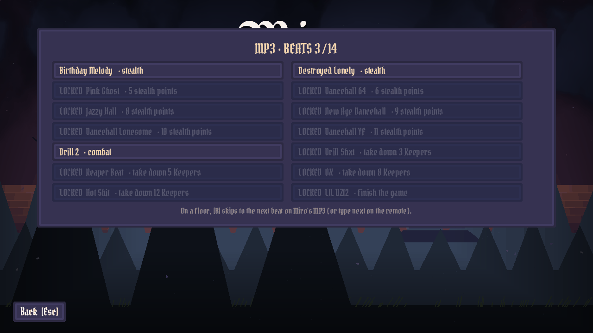

  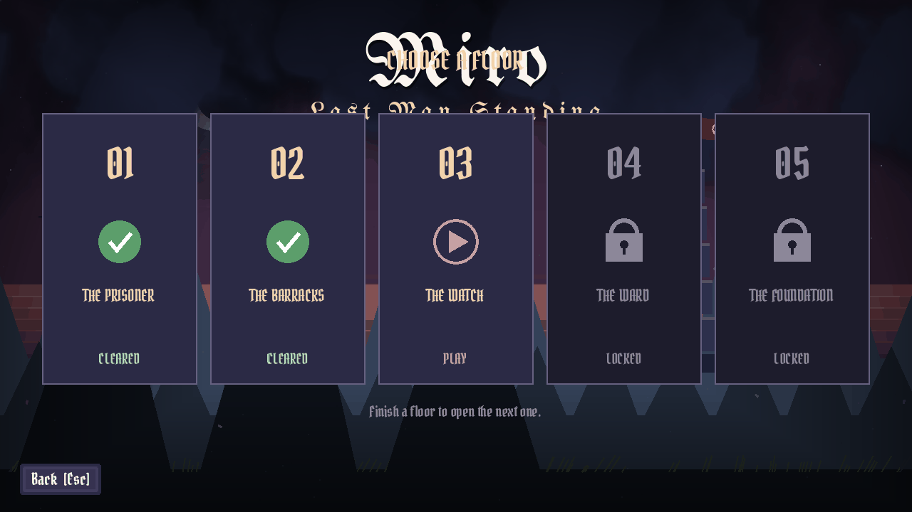
  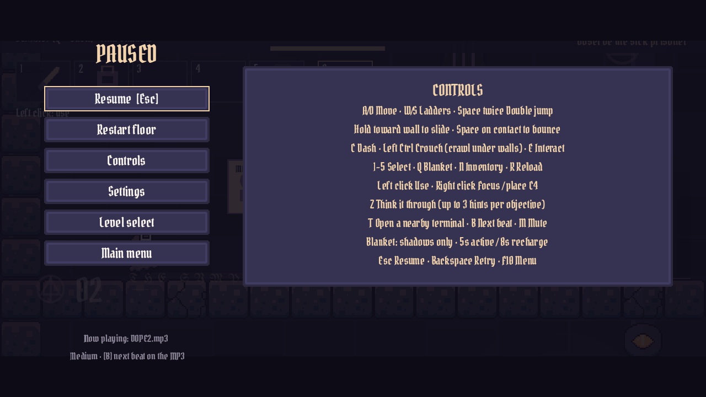

## Tech stack

- **Engine:** Godot 4.7 (Forward+), written in GDScript, rendered at 640×360 and scaled up for pixel art
- **Levels and story:** JSON data in `data/`, with Python and GDScript tools that build the level scenes from it
- **Music:** original soundtrack by RXLA, played by a music director that also acts as a beat clock, so guards and waves move on the beat
- **Voices:** ElevenLabs (`eleven_v3`), generated at build time
- **Art:** original sprites and tiles by Julia, Kenney CC0 asset packs provided by Fran, and public-domain paintings with checked rights
- **Testing:** headless Godot test scripts (`Run Checks.ps1`) and a bot that plays through all five floors (`Check Exported Playthrough.ps1`)
- **Build:** Windows export with `Build Windows.ps1`

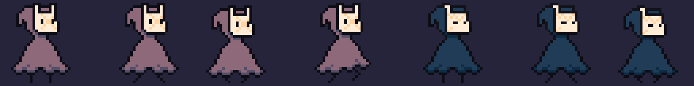

To play from source, open the folder in Godot 4.7 or run `Play Miro.ps1` on Windows. Run `git lfs pull` after cloning to get the music.
